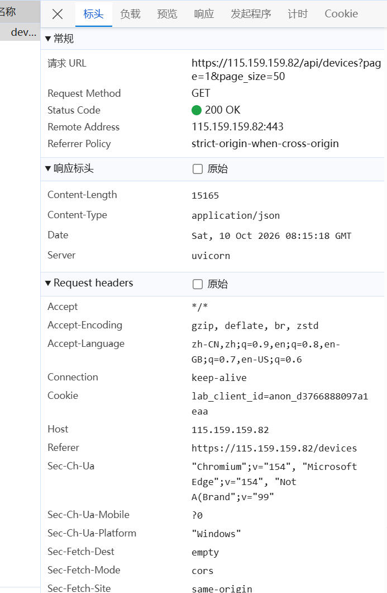
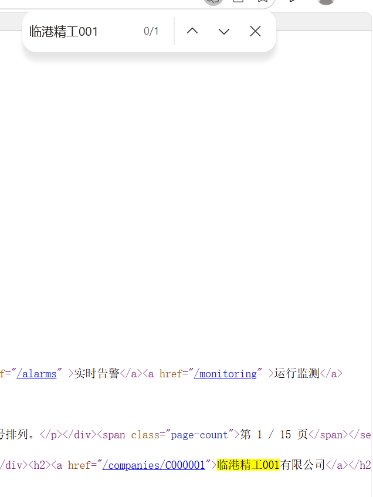
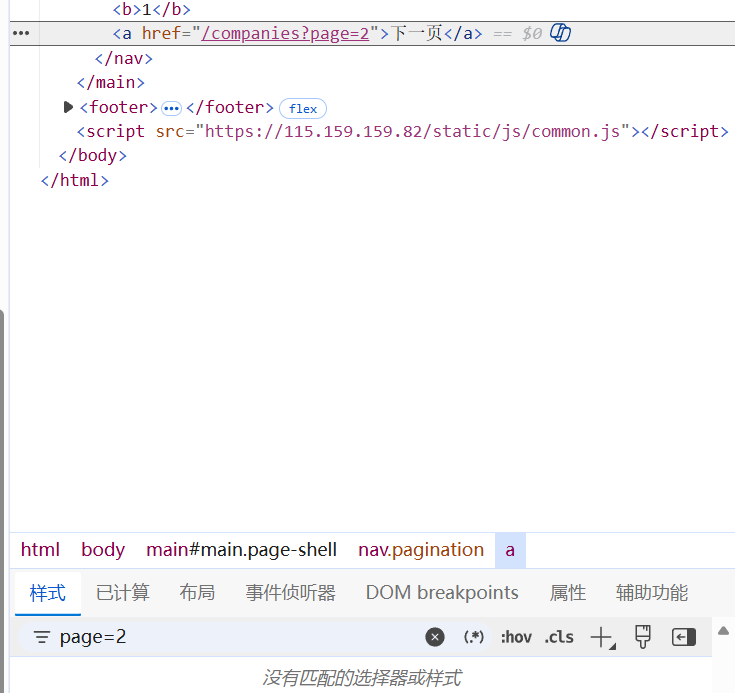
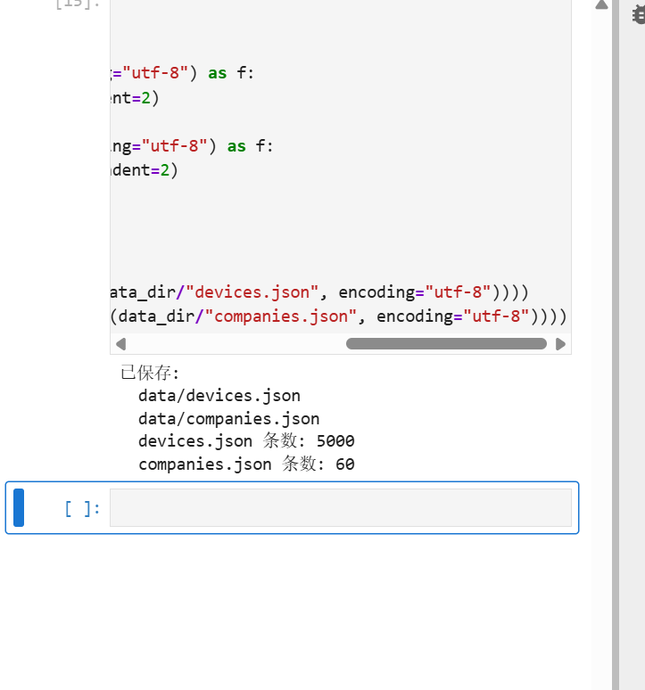

# Lab 1 实验报告

## 学生信息

- **姓名：** 王永亮
- **学号：** 112404260117
- **班级：** 数据1241
- **GitHub 用户名：** ljr050225
- **仓库地址：** https://github.com/ljr050225/bigdata-collection-labs-112404260117

> 文件位置：`lab01/REPORT.md`
> 完整代码保存在 `lab1_html_api.ipynb`。
> 本报告只填写关键发现、关键代码、结果和指定截图，**不要把整份 Notebook 复制进来**。

---

# 任务 1：判断数据加载方式

## 1.1 Device：判断动态加载并找到 API

### 判断结果

- 页面：`/devices`
- 数据加载方式：`动态加载`
- 判断依据：

在"查看网页源代码"中搜不到页面上显示的任何设备名称，设备表格位置只有一句"正在加载…"，说明设备数据不是随初始 HTML 一起返回的；随后打开 `F12 → Network → Fetch/XHR` 并刷新页面，找到一个返回设备数据的请求 `GET /api/devices?page=1&page_size=50`，响应为 JSON，其中包含 `total=5000` 与 `items` 列表，因此判定为动态加载。

### API 信息

- Request URL：`https://115.159.159.82/api/devices?page=1&page_size=50`
- Request Method：`GET`
- Query 参数：`page=1`、`page_size=50`

### 【截图 1】Device API 发现证据

文件名：

```text
images/01_device_api.png
```

**截图内容必须是浏览器 DevTools，不是 Jupyter 代码。**

截图中应能看清：

1. 浏览器的 **Network** 面板；
2. 已选中真正返回设备列表的 Fetch/XHR 请求；
3. 右侧 **Headers** 中的 Request URL；
4. Query String Parameters（或 URL 中的分页参数）。

> 不要截整个桌面；尽量裁剪到 Network 请求和右侧 Headers 区域。

插入：

```markdown

```


---

## 1.2 Company：判断静态加载

- 页面：`/companies`
- 数据加载方式：`静态加载`
- 判断依据：

使用"右键 → 查看网页源代码"后，按 `Ctrl + F` 搜索页面中真实显示的企业名称"临港精工001"，在源代码中直接命中（1/1），并能在 `<article class="company-card" data-company-id="C000001">` 节点中看到该企业名称与 `所属行业 / 所在区域 / 员工规模 / 设备数量` 等字段。企业数据随初始 HTML 一起返回，因此判定为静态加载，可直接请求 HTML 后用 BeautifulSoup 解析。

### 【截图 2】Company 静态加载证据

文件名：

```text
images/02_company_source.png
```

**截图内容必须是"查看网页源代码"页面，不是 Elements，也不是 Jupyter。**

截图中应能看清：

1. 浏览器正在显示 `/companies` 的网页源代码；
2. 使用 `Ctrl + F` 搜索一个页面中真实存在的企业名称；
3. 源代码中能看到该企业名称或对应企业记录。

插入：

```markdown

```


---

# 任务 2：Device API 分页采集

## 2.1 API 分页结构

填写你实际从 JSON 中观察到的字段：

| 含义 | JSON 字段 |
|---|---|
| 当前页 | `page` |
| 每页条数 | `page_size` |
| 设备总数 | `total` |
| 设备列表 | `items` |

---

## 2.2 关键代码

只填写分页采集的核心部分，不要粘贴整个 Notebook。

```python
# 从第一页响应中读取分页信息
total = data["total"]
page_size = data["page_size"]

total_pages = (total + page_size - 1) // page_size

devices = []

for page in range(1, total_pages + 1):
    r = requests.get(
        api_url,
        params={
            "page": page,
            "page_size": page_size
        },
        timeout=10
    )

    page_data = r.json()
    page_items = page_data["items"]
    devices.extend(page_items)
```

---

## 2.3 采集结果

- 每页条数：50
- 设备总数：5000
- 程序计算得到的总页数：100
- 最终采集设备数：5000
- 唯一 `device_id` 数：5000

回答：

> 为什么总页数应由 API 返回的 `total` 和 `page_size` 计算，而不是直接在代码里写死？

答：`total` 是接口当前真实的数据总量，会随数据增减而变化。如果写死页数，数据变多时会漏采、数据变少时会多请求无效页；直接用 `(total + page_size - 1) // page_size` 动态计算，既能保证采全，又能自动适应接口和数据量的变化，代码也更通用。

---

# 任务 3：Company HTML 解析

## 3.1 企业记录 Selector

- 企业记录 selector：`article.company-card`
- 第 1 页企业记录数：20

说明为什么选择这个 selector：

- 主要使用了 `id / class / data-* / 父子层级` 中的哪一种？——主要使用 **class**（`company-card`）定位记录本身，另外用 **data-\*** 属性（`data-company-id`）取出企业编号。
- 是否参考过浏览器 Copy selector 或 AI？——参考过 Copy selector，但它给出的是很长的 `nth-child(...)` 路径，对页面结构变化很敏感。
- 最终为什么采用现在这个写法？——`article.company-card` 短、语义明确，且每条企业记录都是同类节点，浏览器直接 Copy 出来的长路径一旦页面顺序变化就会失效。字段在记录内部再用 `h2 a`、`.badge`、`dl > div` 逐层提取，写法更稳定。

---

## 3.2 关键代码

只填写"记录定位 + 一条记录的关键字段"。

```python
cards = soup.select("article.company-card")

card = cards[0]

company_id = card.get("data-company-id")
name = card.select_one("h2 a").get_text(strip=True)
status = card.select_one(".badge").get_text(strip=True)
```

行业、区域、设备数量使用 `dt/dd` 结构后，请写出你最终如何得到：

```python
industry = details["所属行业"]
zone = details["所在区域"]
device_count = int(re.search(r"\d+", details["设备数量"]).group())
```

---

## 3.3 字段来源说明

任选 **2 个字段**说明：

1. 字段：`company_id`
   - 来自：`HTML 属性`
   - 使用的方法：`card.get("data-company-id")`，读取 `<article>` 上的 `data-company-id` 属性（如 `C000001`）。

2. 字段：`name`
   - 来自：`文本`
   - 使用的方法：`card.select_one("h2 a").get_text(strip=True)`，先定位标题内的 `<a>` 再取文本，`strip=True` 去掉首尾空白。

---

# 任务 4：Company "下一页"分页

## 4.1 下一页元素

- "下一页" selector：`nav.pagination a`（按文本 == `下一页` 过滤）
- 第 1 页 `href` 示例：`/companies?page=2`

### 【截图 3】Company "下一页"元素

文件名：

```text
images/03_company_next.png
```

**截图内容必须是浏览器 DevTools 的 Elements 面板。**

截图中应能看清：

1. 页面底部"下一页"对应的 `<a>` 元素被选中；
2. 该元素的 `class`、`href` 等关键属性；
3. 能判断你为什么使用当前 selector。

> 不需要截 Python 代码；这一张图只证明你找到了正确的 DOM 元素。

插入：

```markdown

```


---

## 4.2 关键代码

```python
next_link = next(
    (a for a in soup.select("nav.pagination a") if a.get_text(strip=True) == "下一页"),
    None
)

next_href = next_link.get("href")

next_url = urljoin(
    current_url,
    next_href
)
```

> 说明：`nav.pagination` 内的第 1 个 `<a>` 可能是"上一页"，因此不能直接写 `soup.select_one("nav.pagination a")`，必须**按文本精确匹配 `下一页`**，否则从第 2 页开始会往回跳、采到重复数据。

再用 2～3 句话说明：

> 你的程序如何完成"当前页 → 找下一页 href → 请求下一页 → 再解析"的循环？

答：先把 `/companies` 设为当前 URL，请求后解析出本页 20 条企业；然后在当前页的 soup 里按文本找到"下一页"的 `<a>`，用 `urljoin` 把相对 `href` 拼成绝对地址作为下一轮的 URL；循环重复"请求 → 解析 → 找下一页"三步，连续采集 3 页后结束。

---

## 4.3 三页采集结果

| 页码 | 企业数 |
|---|---:|
| 1 | 20 |
| 2 | 20 |
| 3 | 20 |
| **合计** | **60** |

- 唯一 `company_id` 数：60

---

# 任务 5：结果验证

## 5.1 最终结果

| 检查项 | 结果 |
|---|---:|
| Company 总数 | 60 |
| 唯一 `company_id` | 60 |
| Device 总数 | 5000 |
| 唯一 `device_id` | 5000 |
| Company–Device 不一致企业数 | 0 |

### 【截图 4】最终验证结果

文件名：

```text
images/04_validation.png
```

**截图内容必须是 JupyterLab 的运行结果，不是代码截图，也不是浏览器截图。**

截图中应能同时看清以下输出：

```text
Company 总数
唯一 company_id 数
Device 总数
唯一 device_id 数
Company–Device 不一致企业数
```

建议把这几个 `print()` 放在同一个 Notebook 单元格中运行后截图。

插入：

```markdown

```


---

## 5.2 一致性检查关键代码

只填写最关键的比较逻辑：

```python
from collections import Counter

device_counts = Counter(
    x["company_id"] for x in devices
)

mismatch_count = 0

for company in companies:
    cid = company["company_id"]
    expected = company["device_count"]
    actual = device_counts.get(cid, 0)

    if expected != actual:
        mismatch_count += 1
```

回答：

> 为什么 `status_code == 200` 仍然不能说明"数据已经采集正确"？

答：`200` 只表示这次 HTTP 请求成功、服务器返回了响应，它并不保证返回内容完整、字段取值正确，也不能说明分页有没有漏采或重复。要确认数据正确，还要额外校验：采集条数是否等于接口 `total`、主键（`device_id` / `company_id`）是否唯一、以及 Company 页面 `device_count` 与 Device 接口按 `company_id` 统计出的实际数量是否一致。只有这些检查都通过，才能说明采集正确。

---

# 任务 6：保存采集结果

确认已经生成：

```text
data/companies.json
data/devices.json
```

填写：

- `companies.json`：`已生成`
- `devices.json`：`已生成`

不需要截图 JSON 全文，也不需要把 JSON 内容复制到报告。

---

# 实验结论

用 **80～150 字**总结：

1. 静态加载与动态加载页面的处理方式有什么不同；
2. HTML "下一页"分页和 API `page` 分页有什么不同；
3. 你使用了哪些方法验证采集结果。

答：静态加载页面的数据随 HTML 返回，用 requests 取 HTML 后用 BeautifulSoup + CSS Selector 直接解析；动态加载页面的数据由 JS 通过 API 异步获取，需先在 Network 找到接口，再请求并解析 JSON。HTML 分页靠页面里的"下一页"链接逐页跳转，要解析 DOM 取下一个 href；API 分页靠 `page`/`page_size` 参数循环请求，总页数由 `total` 算出。验证时我核对了数量是否等于 `total`、主键是否唯一，并用 Counter 统计各企业设备数与页面 `device_count` 比对，结果完全一致。
