# 实验二报告：房源采集与 MySQL 存储

- 班级：数据1241
- 姓名：王永亮
- 学号：112404260117
- 实验日期：2026-10-27（环境、采集与 CSV）／ 2026-11-05（MySQL 入库与核对）
- GitHub 仓库链接：https://github.com/ljr050225/bigdata-collection-labs-112404260117
- 源码文件名：lab02/anjuke.ipynb
- 数据库与表：`smartpark_lab.houseinfo`
- 数据来源：在线教学站 http://www.bspider.top/anjuke/（10 页全部在线采集成功）
- 访问时间及结果（若失败，填写状态码、页面标题或报错）：2026-10-27 16:35—16:48 在线采集；10 页均返回 200，标题「重庆二手房房产网，重庆二手房出售，重庆买房购房交易信息 - 58安居客」，单页约 280 KB，共 600 条。期间站点 chunked 传输多次中断（Read timed out，靠重试完成），并出现过约 6 KB、状态码 200 的「访问验证-安居客」页，已判为异常重试，没有把验证页当房源页解析。
- 快照文件来源与文件名（在线实验可写“不适用”）：本次在线抓取时逐页自行保存的原始 HTML，`page_01.html` ~ `page_10.html`，放在 `lab02/html/`，供离线回放与逐字段核对使用。

> 填写要求：截图放在 `images/` 中，在对应位置插入图片。代码截图要显示文件名、行号或单元位置，用红框标出关键代码，每项写2—3句话解释。只截最终结果或只贴 AI 生成的文字，不能代替实验过程。未完成的项目写明原因，不填写预期结果，不展示个人账号密码。

## 第一阶段：MySQL Docker 更新与启动

- 本次是否需要更新：已完成更新（使用 L05 增量更新包，保留原 L05 教学数据卷，没有删卷或重建）
- 更新或启动遇到的问题：无。按 `start-course.bat` → `start-mysql.bat` → `mysql-console.bat` 的顺序启动，MySQL 脚本直接输出两条 `[PASS]`，账号连接检查通过；镜像为 `mysql:8.4.11`。

### 启动环境与建表

依次使用 `start-course.bat`、`start-mysql.bat`、`mysql-console.bat` 启动课程环境、数据库和 MySQL 终端。

**截图：** MySQL 启动成功提示，以及终端中 `USE smartpark_lab`、`SHOW TABLES`、`DESCRIBE houseinfo` 的执行结果。可分图。

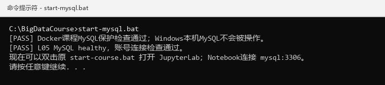

> `start-mysql.bat` 执行结果：Docker 课程 MySQL 保护检查通过，第二行 `[PASS] L05 MySQL healthy，账号连接检查通过。` 就是健康检查与账号连接检查都成功的标志，第三行提示可以继续打开 JupyterLab。

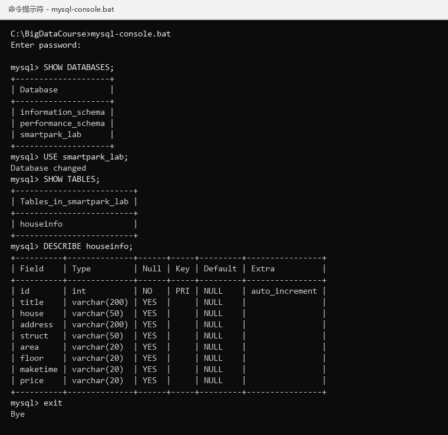

> `SHOW DATABASES` 看到 `smartpark_lab`；`USE smartpark_lab` 后 `SHOW TABLES` 只有 `houseinfo` 一张表；
> `DESCRIBE houseinfo` 显示 9 列：`id` 为 `int auto_increment` 主键，其余 8 列都是 `varchar`。

说明：当前使用哪个数据库？`id` 和8个房源字段分别保存什么？

答：当前使用 `smartpark_lab` 库，表是 `houseinfo`。`id` 是自增长主键，由 MySQL 自动生成，用来唯一标识一行，不代表房源编号；其余 8 列对应采集到的 8 个字段，顺序为 `title`（标题）、`house`（楼盘）、`address`（地址）、`struct`（户型）、`area`（建筑面积，保留 `㎡`）、`floor`（楼层，如“低层(共27层)”）、`maketime`（建造年代，如“2019年建造”，缺失时为空字符串）、`price`（每平方米单价，如“16465元/㎡”）。面积和单价暂时按 `varchar` 保存，保留单位不做换算，方便和网页原文逐字核对。

## 第二阶段：房源采集与 CSV 数据存储

### 1. 网页分析与房源解析

#### 选择器是怎样得到的

在 Chrome 中按 F12，使用 **Elements → Copy → Copy selector**。选一个字段，记录从完整路径到相对选择器的过程。

- 选择的字段：标题（title）
- 复制的原始选择器：#__layout > div:nth-child(1) > section:nth-child(2) > section:nth-child(3) > section:nth-child(1) > section:nth-child(4) > div:nth-child(1) > a:nth-child(1) > div:nth-child(2) > div:nth-child(1) > div:nth-child(1) > h3:nth-child(1)
- 一条房源的父容器选择器：div.property
- 最终使用的相对选择器：h3.property-content-title-name

**截图：** 框出该字段的 HTML 节点和房源父容器，展示选择器的匹配结果。

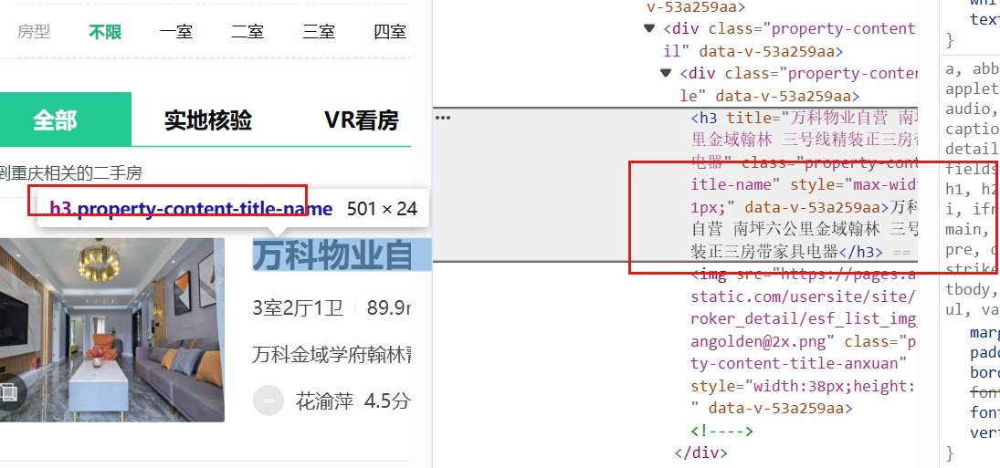

> 左：Elements 选中标题节点，悬浮提示 `h3.property-content-title-name`；右：该 `<h3>` 的完整节点，`title` 属性保存了未被省略号截断的完整标题。

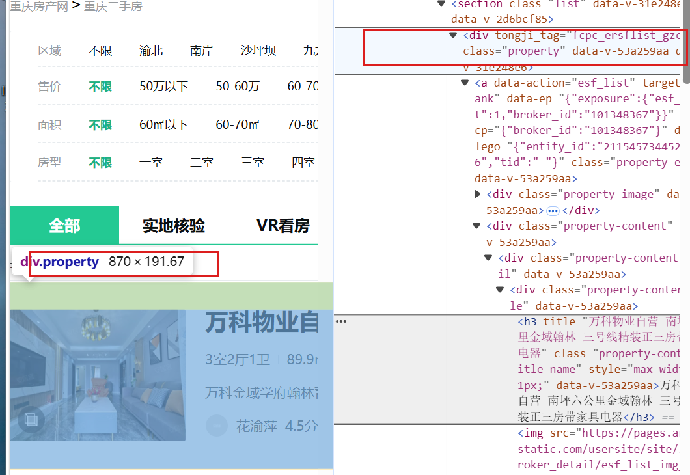

> 父容器 `div.property`（悬浮提示尺寸 870 × 191.67），它同时包住图片、标题、户型面积、楼盘和经纪人信息，因此可作为“一条房源”的解析单位。

说明：删掉了哪些层级？怎样确认父容器刚好包含一条房源？

答：原始路径一共 12 层，前面 `#__layout` 及中间 10 层祖先（多个 `section`、`div`、`a`）和全部 `:nth-child()` 都删掉了，只保留能唯一定位一条房源的 `div.property`，再在它内部用 `h3.property-content-title-name` 取标题；页面只要多插入一个元素，按位置选择的原始路径就会失效，按 class 的相对选择器不会。

确认父容器刚好包住一条房源用了三条依据：① 在 Elements 中悬停 `div.property`，高亮框正好框住一整张卡片（图片 + 标题 + 户型面积 + 楼盘地址 + 单价）；② `soup.select("div.property")` 在本页返回 60 条，与页面上看到的房源卡片数一致；③ 对每条房源单独取 `row.select_one("h3.property-content-title-name")` 都能取到文字，说明没有少取也没有取到卡片外的节点。

#### 解析8个字段

**截图：** 自己编写的解析代码和首条房源的8个字段输出。代码中必须框出：

- `select()` 和 `select_one()`。
- 面积、单价的定位与取值。
- 建造年代的提取和缺失处理。

可分成几张局部截图。另附面积、单价对应的 HTML 节点或网页原文。

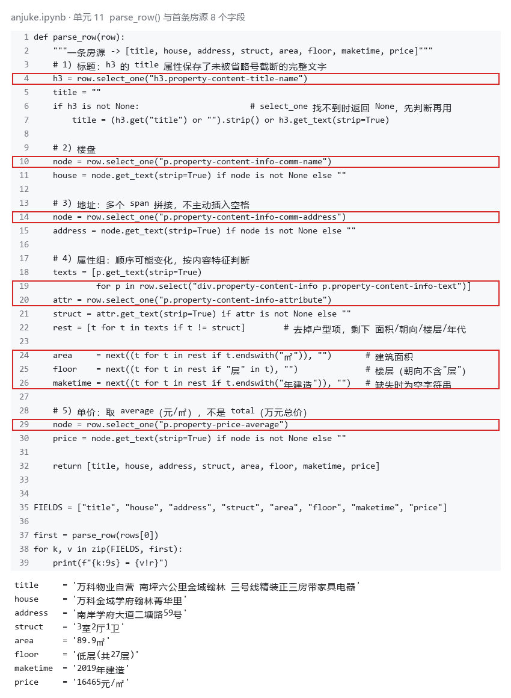

> 单元 11：`parse_row()` 用 `select_one()` 取标题、楼盘、地址、户型、单价，用 `select()` 取属性组全部 5 项；
> 面积取以 `㎡` 结尾的项，楼层取含「层」的项，年代取以「年建造」结尾的项。下方是第一条房源的实际输出。

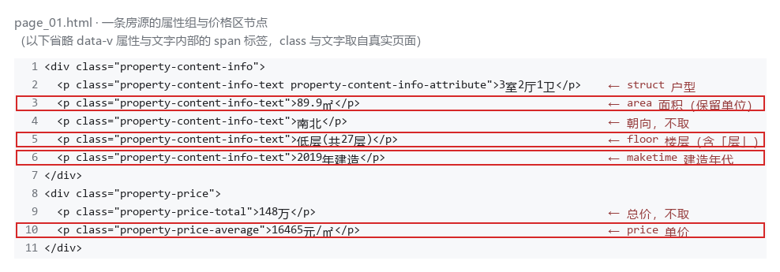

> 左侧为属性组 5 个 `
` 的实际顺序（户型 / 面积 / 朝向 / 楼层 / 年代），
> 右侧为价格区：`property-price-total` 是总价「148万」，`property-price-average` 才是单价「16465元/㎡」。

说明：两个选择方法各用在哪里？怎样确认面积和单价没有取错？

答：`select()` 用在「取多条」的地方——一页的全部房源 `row.select("div.property")`，以及一条房源内的属性组 `row.select("div.property-content-info p.property-content-info-text")`（每条 5 项）；`select_one()` 用在「取唯一节点」的地方——标题、楼盘、地址、户型、单价各只有一个，找不到时返回 `None`，所以每次都先判断 `is not None` 再取文字。

面积不写死下标，而是在属性组里挑 `endswith("㎡")` 的项；楼层挑含「层」的项，朝向是「南 / 北 / 南北 / 东南」，不含「层」，所以不会把朝向取成楼层；年代挑 `endswith("年建造")` 的项，本页 600 条都能取到，缺失时返回空字符串。单价取 `p.property-price-average`（16465元/㎡），总价在另一个节点 `p.property-price-total`（148万），两个节点分开取，不会混淆。核对时打印了第一条、第二条和本页最后一条的 8 个字段，与网页原文逐字比对一致。

### 2. 下一页采集

- 下一页 `href` 原值：`?page=2`
- 用 `urljoin()` 补全后的地址：`http://www.bspider.top/anjuke/?page=2`
- 实际停止原因（明确禁用的末页按钮 / 异常中止）：正常结束——采到第 10 页时分页区域仍存在，但「下一页」按钮已禁用（`a.next` 上没有 `next-active`），此时累计 600 条。

**截图：** 框出提取 `href`、补全地址、循环更新地址和停止条件的代码。附前两页的运行日志，以及最终停止提示。离线实验展示快照中的href、补全结果和文件读取记录，注明“离线回放”，不算在线翻页成功。

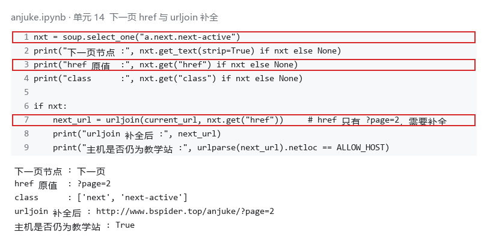

> 单元 14：先用 `select_one("a.next.next-active")` 取节点，再用 `get("href")` 取地址（不是 `get_text()`，那只是「下一页」三个字），
> 最后用 `urljoin(current_url, href)` 把 `?page=2` 补全成绝对地址。

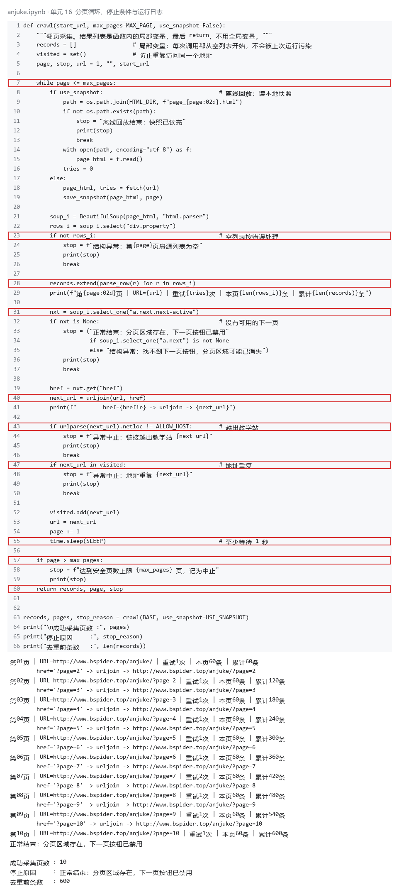

> 单元 16：循环里先解析本页、再取下一页，用 `visited` 防重复、`MAX_PAGE=30` 设上限、`time.sleep(1.5)` 控制频率；
> 日志显示第 01—10 页的 URL、本页条数、累计条数和最终停止原因。

说明：怎样进入下一页？怎样防止重复采集或无限循环？若中途失败，说明停在哪一步。

答：每页解析完后用 `select_one("a.next.next-active")` 找可用的「下一页」按钮，`get("href")` 取到 `?page=2` 这种相对地址，再用 `urljoin(current_url, href)` 补全成 `http://www.bspider.top/anjuke/?page=2`，然后把它设为下一轮的 `url`。

防重复：用 `visited` 集合保存已访问过的地址，出现重复地址立即中止；结果列表回到 Python 后再按 8 个字段完全相同的记录去重（600 条里有 102 条完全重复，去重后 498 条）。防无限循环：循环带 `MAX_PAGE=30` 上限，每页之间 `time.sleep(1.5)`。

停止条件分三种：`a.next` 存在但没有 `next-active` → 末页，正常结束；连 `a.next` 都找不到或本页房源列表为空 → 结构异常，不算采集完成；地址越出教学站、地址重复或达到页数上限 → 记为中止。本次在第 10 页正常结束，中途只遇到传输超时（本次运行第 7 页重试 2 次后成功，其余页面一次拿到），没有停在异常页面上。

### 3. 保存 CSV

**截图：** CSV保存与回读代码、回读条数。框出编码、表头和数据写入部分。

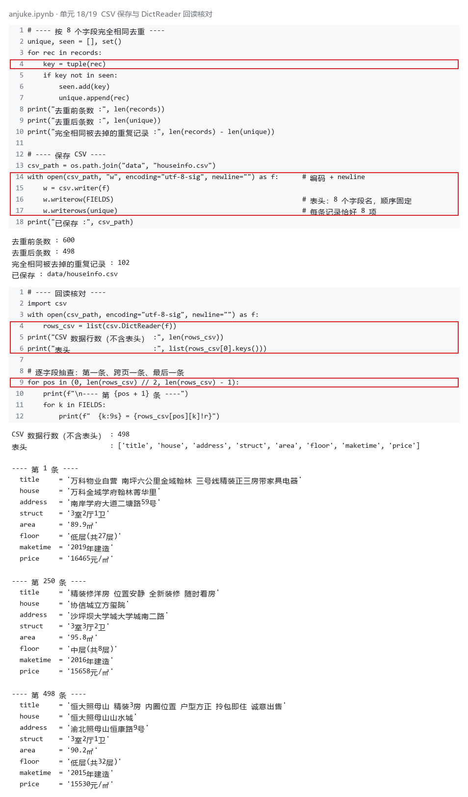

> 单元 18：`csv.writer` 写入，文件用 `utf-8-sig` 编码、`newline=""`，先写 8 个字段的表头，再写去重后的记录；
> 单元 19：用 `csv.DictReader` 回读，数据行数 498（不含表头），并打印第一条、中间一条和最后一条逐字段核对。

说明：8个字段的顺序是什么？按8个字段完全相同去重后，保存了多少条记录？

答：顺序是 `title → house → address → struct → area → floor → maketime → price`，与手册要求一致，也与 `houseinfo` 表中除 `id` 外的 8 列顺序一致，写入时每条记录恰好 8 项。

去重前共 600 条（10 页 × 每页 60 条），8 个字段完全相同的重复记录 102 条（安居客不同页会重复推荐同一套房），去重后保存 498 条到 `data/houseinfo.csv`（一行一套房源）。用 `csv.DictReader` 回读，数据行数 498（表头不计入，文件总行数 499），表头为这 8 个字段名，8 个字段的空值数都是 0。

## 第三阶段：MySQL 数据存储

### 1. 读取 CSV 并入库

本阶段读取第二阶段的 `data/houseinfo.csv`，不重新采集。

**截图：** 框出读取CSV、按8个字段整理入库参数的代码。

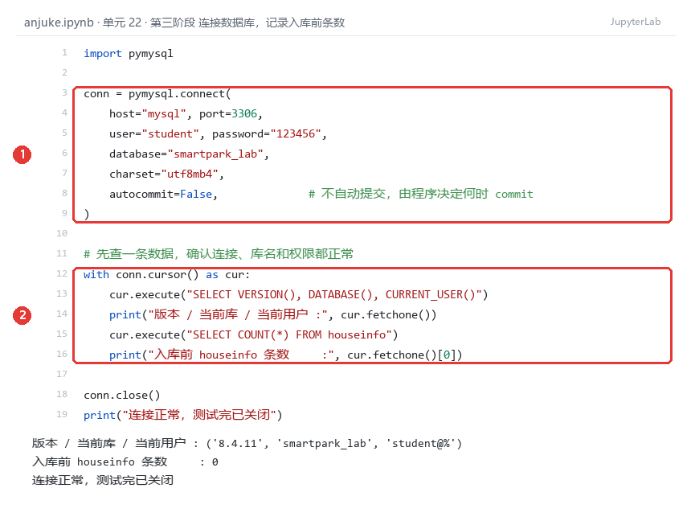

> 单元 22：红框①是 `pymysql.connect()` 的连接参数（`host="mysql"`，不是 localhost），并显式设 `autocommit=False`；
> 红框②先查 `VERSION()/DATABASE()/CURRENT_USER()` 确认连的是哪台库、哪个用户，再查 `COUNT(*)`，输出显示**入库前 0 条**。

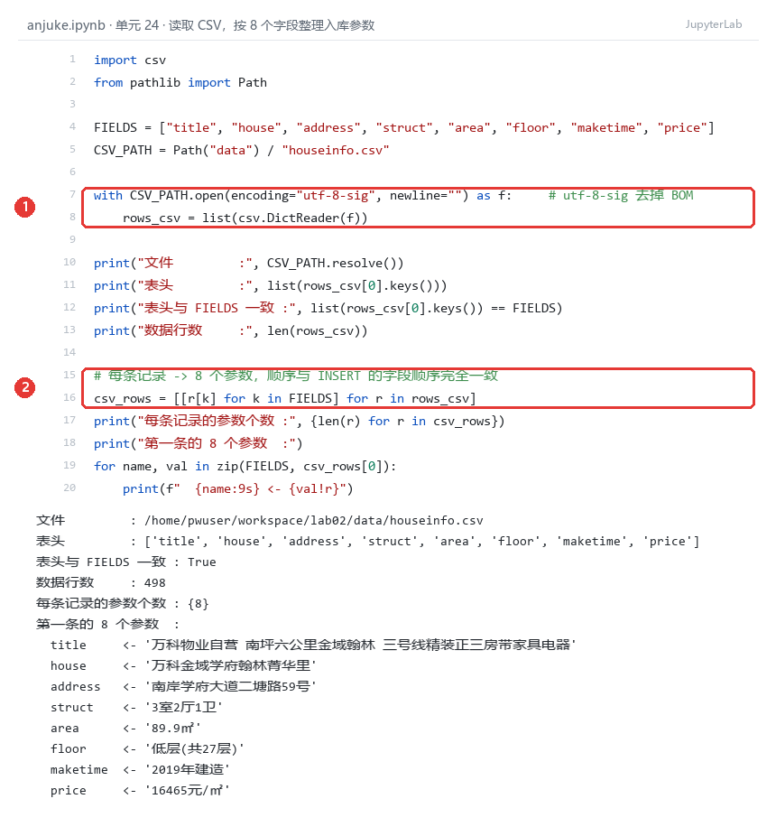

> 单元 24：红框①用 `csv.DictReader` 读取，文件以 `utf-8-sig` 打开去掉 Excel 的 BOM；
> 红框②`[[r[k] for k in FIELDS] for r in rows_csv]` 按固定字段顺序把每行取成 8 个值组成的列表，输出确认“每条记录的参数个数 = {8}”，并打印第一条的 8 个参数。

**截图：** 自己编写的入库代码。框出 `executemany()`、`commit()`、`rollback()`，以及关闭游标和连接的操作。另框出避免重复插入的代码。

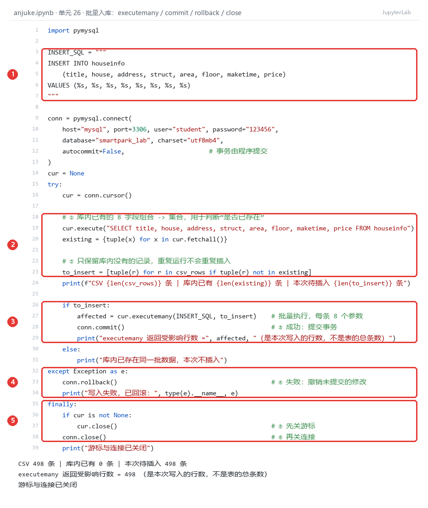

> 单元 26：红框① INSERT 语句里 8 个字段与 8 个 `%s` 一一对应；
> 红框②先 `SELECT` 出库内已有的 8 字段组合做成集合，只保留不存在的记录（避免重复插入）；
> 红框③`executemany()` + `commit()`；红框④`except` 里 `rollback()`；红框⑤`finally` 里先 `cur.close()` 再 `conn.close()`。
> 本次输出：CSV 498 条、库内 0 条、待插入 498 条，`executemany` 返回 498。

说明：每条记录怎样对应8个参数？成功、失败时分别做什么？再次运行时怎样避免重复插入？

答：`csv.DictReader` 把每行读成字典，按 `FIELDS = [title, house, address, struct, area, floor, maketime, price]` 的顺序取 8 个值，得到一个 8 元组；这个元组的顺序与 INSERT 里 8 个字段、8 个 `%s` 的顺序完全一致，所以 `executemany()` 逐条把 8 个值塞进 8 个占位符，不需要手工拼接 SQL，标题里的空格和特殊字符也不会破坏语句。

成功时调用 `commit()` 提交事务，提交之后另一个 MySQL 终端才能查到新数据；失败时进入 `except`，先 `rollback()` 撤销本次事务中尚未提交的修改（已提交的数据和建表语句它撤不掉），再打印异常类型和原因；无论成功还是失败，`finally` 里都先关游标再关连接，连接失败时 `cur` 还是 `None`，所以先判断 `if cur is not None`。

再次运行时，程序先把库内已有的 8 个字段组合读出来放进集合 `existing`，再用列表推导 `to_insert = [tuple(r) for r in csv_rows if tuple(r) not in existing]` 过滤，只插入库里没有的记录。自增 `id` 挡不住重复，所以这里按 8 个字段的整体比较，而不是清空表重来。实测关闭程序后重跑，CSV 498 条、库内已有 498 条、待插入 0 条，表里仍然是 498 条。

### 2. 核对结果

#### 查询条数和样本

**截图：** MySQL 终端中的入库前后 `SELECT COUNT(*)`、重跑后的条数，以及 `SELECT ... LIMIT 5` 的结果。

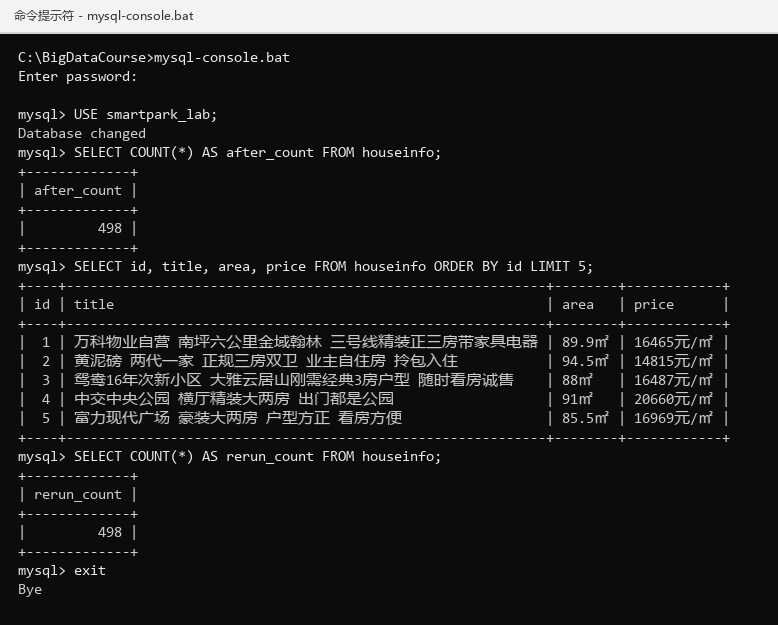

> 在 `mysql-console.bat` 中执行：`SELECT COUNT(*) AS after_count` 得到 498；`SELECT id, title, area, price ... LIMIT 5` 看到 `id` 从 1 连续到 5，面积带 `㎡`、单价带 `元/㎡`；再查一次 `COUNT(*)` 得到 498，说明重跑没有增加记录。入库前的 0 条见单元 22 的输出。

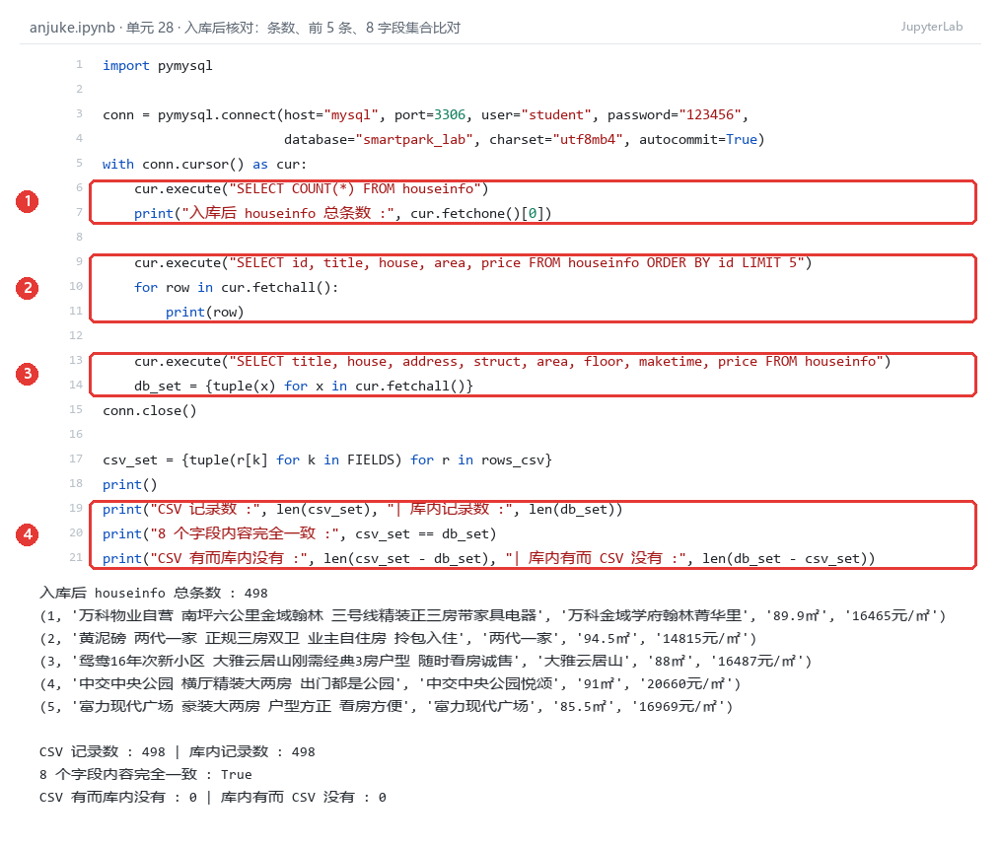

> 单元 28：红框①查总条数 498；红框②查前 5 条；红框③把库里 8 个字段全部取回到集合 `db_set`；
> 红框④与 CSV 的 `csv_set` 比较，输出“8 个字段内容完全一致 : True，CSV 有而库内没有 0，库内有而 CSV 没有 0”。

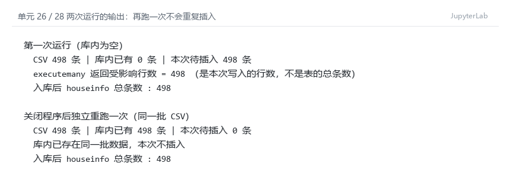

> 第一次运行库内为空，待插入 498 条、`executemany` 返回 498；关闭程序后独立重跑一次，库内已有 498 条、待插入 0 条，提示“库内已存在同一批数据，本次不插入”，总条数仍是 498。

| 项目 | 实际结果 |
|---|---|
| 成功采集页数 | 10 |
| 采集记录数（去重前） | 600 |
| 完全相同的重复记录数 | 102 |
| CSV数据行数（不含表头） | 498 |
| 入库前条数 | 0 |
| 入库后条数 / 本次新增条数 | 498 / 498 |
| 关闭上次程序后，同批数据独立重跑的条数 / 新增条数 | 498 / 0 |
| 是否采集完整；未完成的原因 | 采集完整：10 页全部成功，第 10 页「下一页」按钮已禁用后正常结束，共采集 600 条，去重后保存 498 条 |

说明：首次入库后的条数应等于去重后的CSV数据行数，8个字段的内容也应一致。若不一致，说明原因。总条数以实际结果为准。

答：首次入库后 `houseinfo` 共 498 条，等于去重后的 CSV 数据行数 498，新增 498 条，没有多也没有少。把库里 498 行的 8 个字段取出做成集合，与 CSV 的 498 行比较，结果是 `True`，说明每一行的 8 个字段文字、单位、空格都完全相同，数据库只额外多了一个自增 `id`。关闭程序后重跑同一批数据，待插入 0 条、新增 0 条、总数仍是 498，说明去重逻辑有效。本次是新建表（入库前 0 条），所以“入库后条数 = CSV 行数”这一条成立；如果是在已有数据的表上跑，条数会大于本次新增数，那时应看“本次新增条数”，而不是总数。

#### 逐条核对

选取第一条、跨页一条和最后一条，比较网页、CSV与数据库中的8个字段。快照实验对照教师提供的网页文件。

**截图：** 三条样本的对照结果，框出面积、单价和年代。可分图。

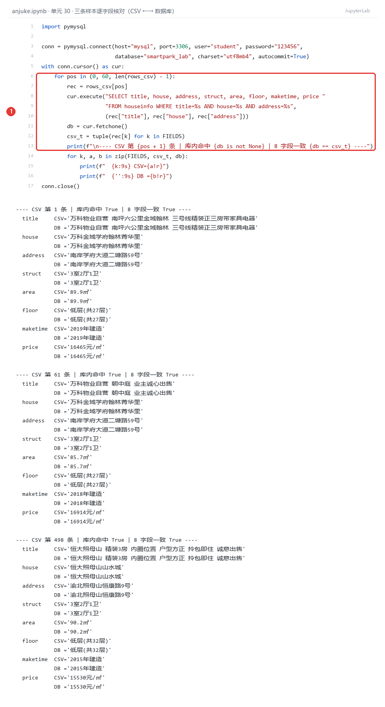

> 单元 30：红框①按 CSV 的位置取第 1、61、498 条，用标题+楼盘+地址去库里查，再把 CSV 值与库内值成对打印。
> 三条样本的“库内命中 True、8 字段一致 True”，面积（89.9㎡ / 85.7㎡ / 90.2㎡）、单价（16465 / 16914 / 15530 元/㎡）和年代（2019 / 2018 / 2015 年建造）两列完全相同。

- 样本1（页码或URL、记录位置）：第 1 页 `page_01.html` 第 1 条房源，即 CSV 第 1 行（`id=1`）——万科物业自营 南坪六公里金域翰林 三号线精装正三房带家具电器 / 万科金域学府翰林菁华里 / 南岸学府大道二塘路59号 / 3室2厅1卫 / 89.9㎡ / 低层(共27层) / 2019年建造 / 16465元/㎡
- 样本2（页码或URL、记录位置）：第 2 页 `page_02.html` 第 1 条房源（跨页样本），即 CSV 第 61 行（`id=61`）——万科物业自营 朝中庭 业主诚心出售 / 万科金域学府翰林菁华里 / 南岸学府大道二塘路59号 / 3室2厅1卫 / 85.7㎡ / 低层(共27层) / 2018年建造 / 16914元/㎡
- 样本3（页码或URL、记录位置）：第 10 页 `page_10.html` 第 60 张卡片（该页最后一条），即 CSV 最后一行第 498 条（`id=498`）——恒大照母山 精装3房 内圈位置 户型方正 拎包即住 诚意出售 / 恒大照母山山水城 / 渝北照母山恒康路9号 / 3室2厅1卫 / 90.2㎡ / 低层(共32层) / 2015年建造 / 15530元/㎡

核对结论及差异：三条样本的 8 个字段在“网页快照原文 → CSV → 数据库”三处完全一致，没有差异。重点核对的三项：面积都带 `㎡` 且是小数形式（89.9㎡、85.7㎡、90.2㎡）；单价都是 `元/㎡` 的每平方米价格（16465、16914、15530），不是网页上「148万」这类总价；建造年代都带「年建造」后缀（2019、2018、2015），没有出现空值，也没有把朝向当成楼层（楼层是“低层(共27层)”这种带“层”的写法）。跨页的第 61 条与第 1 条同属一个楼盘、地址相同但面积年代不同，说明没有把相邻房源串行，也没有把重复记录当成新记录。

## 问题与解决

- 遇到的问题、处理方法及结果（没有可写“无”）：① 站点 chunked 传输经常中途断开，`requests` 抛 `Read timed out`，本次运行第 7 页重试 2 次才拿到，另一次独立抓取中第 2、3、6 页各重试 2~3 次；处理方法是把请求封装成 `fetch()`，失败重试、http/https 回退、超时时间设为 `(10, 40)`。② 请求偶尔返回约 6 KB 的「访问验证-安居客」页，状态码仍是 200；处理方法是按页面长度判断（`len(html) < 5000` 视为验证页）并重试，不把验证页交给 BeautifulSoup 解析。③ Notebook 单元在 nbformat 读写时多行被合并成一行导致 `SyntaxError`；处理方法是单元源码每行保留行尾换行。结果：10 页全部采集成功，600 条去重后保存 498 行 CSV。④ 第三阶段第一次执行时报 `FileNotFoundError: data/houseinfo.csv`：内核的工作目录不是 `lab02/`，`Path("data")` 相对路径找不到文件；处理方法是把内核工作目录切回 `lab02/`（Notebook 与 `data/`、`html/` 同级）后再运行，单元 24 打印的绝对路径是 `.../lab02/data/houseinfo.csv`，确认读的是第二阶段那份文件。⑤ CSV 由 Excel 打开过会有 BOM，用 `utf-8` 读第一列字段名会变成 `\ufefftitle`；处理方法是读写都用 `encoding="utf-8-sig"`，回读时表头与 `FIELDS` 比较结果为 `True`。⑥ 第一次写重跑逻辑时想直接 `TRUNCATE` 清表，会丢掉已有数据且不符合要求；改为按 8 个字段比对后只插入新记录，重跑新增 0 条。
- 尚未解决的问题、未完成的步骤（没有可写“无”）：无。第二阶段 10 页采集、CSV 去重后 498 行已完成；第三阶段已完成读取 CSV、批量入库 498 条、条数与逐字段核对、重跑不重复插入；第一阶段建表与表结构截图已补齐。GitHub 上传与学习通提交需本人操作。

## 思考题

1. 本次怎样实现下一页采集？结合自己的代码说明。

   答：每一页解析完后，用 `soup.select_one("a.next.next-active")` 找「下一页」按钮，用 `.get("href")` 取出地址（本页是 `?page=2`），再用 `urljoin(current_url, href)` 补全成 `http://www.bspider.top/anjuke/?page=2`，赋给 `url` 进入下一轮。停止条件是：能找到 `a.next` 但它没有 `next-active`，说明按钮已禁用、到达末页，正常结束（本次停在第 10 页）；如果连 `a.next` 都找不到、本页房源为空、地址越出 `www.bspider.top` 或地址重复，就记为结构异常或中止，不算采集完成。

2. 旧代码把 out_list 定义在全局。你把结果列表放在哪里？为什么？

   答：放在 `crawl()` 函数内部的局部变量 `records`，采集结束后 `return records, page, stop_reason` 返回。这样每次调用函数都从空列表开始，不会把上一次运行的结果带进来，重复运行也不会越加越多；调用方拿到返回值后再决定去重和保存，函数内部不改动外部变量，便于单独测试。

3. 你怎样获取建造年代？节点缺失或顺序改变时，怎样处理？

   答：先用 `select()` 取出 `div.property-content-info` 下全部 `p.property-content-info-text` 的文字，得到 `['3室2厅1卫', '89.9㎡', '南北', '低层(共27层)', '2019年建造']`，再用 `next((t for t in rest if t.endswith("年建造")), "")` 挑出以「年建造」结尾的项，所以顺序改变也能取到；节点缺失时 `next()` 的默认值是空字符串，按手册要求填空，不会抛异常。本次 600 条全部取到了年代，空值数为 0。取下标前也先确认了属性组长度，不只判断列表非空。

## 提交检查

- [ ] 实验一原仓库的 `lab02/` 中已有源码、CSV、报告和真实截图。
- [ ] 截图清楚，关键代码已框出，每项附有个人解释。
- [ ] GitHub上能打开文件和图片，未上传个人账号密码、`.env`或教师答案。
- [ ] 未完成项已如实说明；学习通只交原仓库链接。

如使用 AI，简述它帮助了什么，以及自己修改、运行和核对了什么：

AI 帮助把 `select_one` / `select` 的选择器写法、翻页循环的停止条件整理成代码框架，并解释了 `urljoin`、`csv.writer` 的 `utf-8-sig` 与 `newline=""` 的作用；第三阶段帮我理顺了 `executemany()` 的参数顺序、`try/except/finally` 里 `commit()` 与 `rollback()` 的分工，以及“按 8 个字段比对去重”的写法。我自己在 JupyterLab 中运行了全部单元，核对了第一条、第二条和本页最后一条房源的 8 个字段与网页原文，确认面积带 `㎡`、单价是 `元/㎡` 而不是「148万」的总价；CSV 回读 498 行与去重结果一致，8 个字段空值数均为 0。入库后我在 `mysql-console.bat` 里自己执行了 `DESCRIBE`、`COUNT(*)` 和 `LIMIT 5`，确认 498 条与 CSV 一致、重跑新增 0 条；三条样本的面积、单价、年代逐字段比对无差异。
